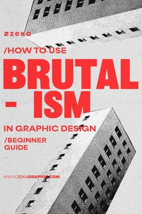
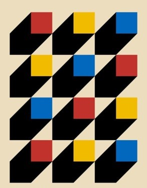
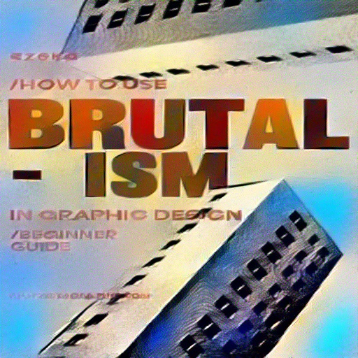
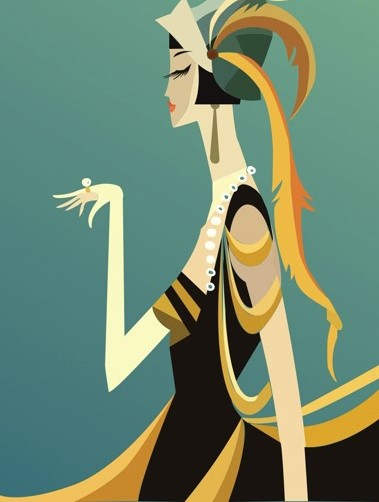
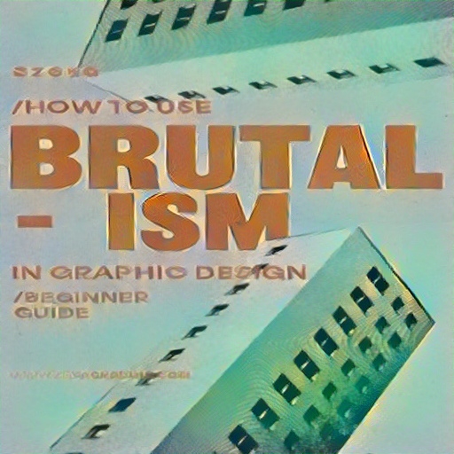

# Neural style transfer

**What would this poster look like as a Bauhaus piece, or in Art Deco gold?** Style transfer on VGG19 features keeps a design's layout and headline type, and repaints it in the colors and textures of a style reference.

| Content | Style | Result |
| :---: | :---: | :---: |
|  |  |  |
| |  |  |

*PyTorch · torchvision · VGG19 · L-BFGS*

## What I did

- Built the transfer on frozen VGG19 features: content from conv4_2 and conv5_1, style from the Gram matrices of five layers, weighted from fine to coarse (1.0 for conv1_1 down to 0.2 for conv5_1).
- Started from the content image with a little noise, so the layout is there from the first step.
- Optimized with L-BFGS in three stages, raising the style weight each time: coarse (200 steps, style weight 5,000), refine (300 steps, 10,000) and polish (200 steps, 15,000).
- Added a smoothness (total variation) term against noise, and wrote color-coherence and perceptual losses as optional terms, switched off in the saved runs.
- Saved each result with an analysis figure: content, style, result, before and after, and the loss curves.

## What the results show

- **Shapes and headline type survive; fine print doesn't.** "BRUTAL-ISM" stays readable in both results, while the web address at the bottom dissolves into texture.
- **Each style needs its own weights.** There is no single setting that suits a flat geometric pattern and a detailed illustration alike.
- **It's slow.** A run takes minutes on a GPU: fine for exploring design directions, not for real time.

## Try it

```powershell
python -m venv .venv
.\.venv\Scripts\python.exe -m pip install -r requirements.txt
.\.venv\Scripts\python.exe NeuralStyleTransfer.py
```

At the prompts, give a content image, a style image and a size (1 for 256 × 256, 2 for 512 × 512):

```text
Content image path: input/BRUTALISM.jpg
Style image path: styles/BAUHAUS.jpg
Choose (1-2): 2
```

The pretrained VGG19 weights download on first use. Results and analysis figures go to `output/`.

## Layout

| Path | What's there |
| --- | --- |
| [`NeuralStyleTransfer.py`](NeuralStyleTransfer.py) | Feature extraction, losses, optimization and the interactive entry point |
| [`styles/`](styles/) | Four style references: Bauhaus, flat, Japanese and luxury |
| [`output/`](output/) | Two results and their analysis figures |

Machine learning final project, University of Isfahan, 2025: one of my first deep learning projects.
